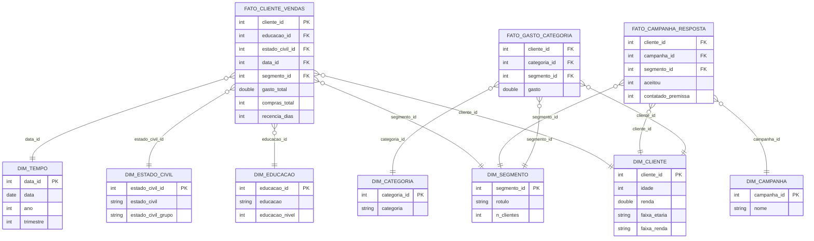

# MVP — Clusterização de clientes e estratégia comercial

**Aluno:** Marina del Giudice Chaves · **Matrícula:** 231025360
**Disciplina:** Sistema de Suporte à Decisão / UnB · Prof. André Luiz Marques Serrano
**Plataforma:** Databricks Free Edition (Delta Lake, arquitetura medalhão) · **Dados:** Kaggle — Customer Personality Analysis

## 1. Objetivo
**Problema:** a empresa trata a base de clientes de forma homogênea.
**Hipótese:** existem segmentos naturais com valor, comportamento e resposta a campanhas diferentes; priorizar o orçamento comercial por segmento aumenta o retorno.

**Perguntas de negócio**
1. **P1.** Quantos segmentos naturais de clientes existem (K-Means sobre RFM + perfil demográfico) e qual o perfil de cada um em renda, composição familiar, gasto e frequência?
2. **P2.** Qual a contribuição de cada segmento para a receita total e o gasto médio por cliente? Que fração dos clientes concentra 80% do gasto (Pareto)?
3. **P3.** Como os segmentos diferem em mix de categorias (vinhos, carnes, peixes, frutas, doces, ouro) e em canal (loja, web, catálogo)? Qual o papel das visitas web e das compras com desconto?
4. **P4.** Qual a taxa de aceitação das campanhas (1 a 5 e a última) por segmento? Sob a premissa declarada custo por contato = Z_CostContact e receita por aceite = Z_Revenue, qual segmento tem melhor retorno estimado? (O significado de Z_* é uma premissa: a base não o documenta.)
5. **P5.** Quais clientes têm alto gasto histórico e recência alta (risco de inatividade) e que ação de retenção/reativação faz sentido para eles?

**Entrega de negócio:** playbook comercial com uma ação por segmento (oferta, canal, prioridade).

## 2. Dados
- **Fonte:** https://www.kaggle.com/datasets/imakash3011/customer-personality-analysis · **Licença:** CC0: Public Domain (conferida em 02/11/2026)
- **Coleta:** 2026-11-08T23:33:52+00:00 (UTC) · 2240 linhas × 29 colunas · 220188 bytes · sha256 `cd0affa36b1b981e80ba0e27767e9b3ab723f7a3dba948f722af81abc6b990ea`
- **Formato original:** CSV separado por TAB. Metadados em `catalogo/metadados_coleta.json`.

## 3. Arquitetura e metodologia
Fluxo: **Kaggle → Volume (Unity Catalog) → Bronze → Silver → Gold → Análise**, orquestrado por um Job do Databricks (Bronze → Silver → Gold → Análise).

| Camada | Notebook | Tabelas Delta |
|---|---|---|
| Bronze | `notebooks/01_bronze_ingestao` | `bronze_marketing_campaign` (todos os registros, texto, + metadados de ingestão) |
| Silver | `notebooks/02_silver_limpeza_features` | `silver_clientes`, `silver_regras_negocio`, `silver_constantes`, `silver_duplicatas_removidas`, `silver_qualidade_*` |
| Gold | `notebooks/03_gold_estrela_cluster` | 3 fatos (`fato_cliente_vendas`, `fato_campanha_resposta`, `fato_gasto_categoria`), 7 dimensões, `gold_clusterizacao_*`, `gold_premissas_p4`, `gold_catalogo_dados` + visões `vw_*` |
| Análise | `notebooks/04_analise_p1_p5` | usa as visões `vw_*` |

Cada notebook existe em `.py` (formato source do Databricks) e `.ipynb`. **`notebooks/MVP_Unificado.ipynb`** reúne tudo em um único notebook com as **saídas (tabelas, gráficos e discussões) embutidas**, para leitura direta no GitHub.

**Modelo:** constelação de fatos (grão: cliente, cliente×campanha, cliente×categoria). Catálogo de dados em `catalogo/catalogo_dados.md` (e `.csv`) e diagrama em `catalogo/diagrama_estrela.png`.




**Qualidade de dados** (`catalogo/qualidade_por_atributo.csv`, `catalogo/qualidade_testes.csv`): nulos em `Income` (24), outlier de renda (666.666), anos de nascimento implausíveis (< 1900), categorias estranhas em `Marital_Status`, `2n Cycle` em `Education`, colunas constantes `Z_*` e **182 registros idênticos exceto o ID** (`catalogo/duplicatas_detectadas.csv`). Regras R1–R11 em `catalogo/regras_transformacao.csv`. Evidência: `evidencias/qualidade_outliers_categorias.png`.

**Clusterização:** K-Means (z-score; recência, compras totais, log do gasto, renda, idade, nº de filhos). `k` pelo maior silhouette com k ≥ 3; estabilidade por 5 sementes (ARI) e bootstrap. seed=42, k de 2 a 8.

## 4. Resultados
Os resultados de P1–P5, a discussão geral, o playbook e as limitações são **gerados dos números da execução** e estão em `notebooks/04_analise_p1_p5` (Databricks) e em `notebooks/MVP_Unificado.ipynb`. O resumo numérico completo está em `resultados/resultados_resumo.json`.

- **P1:** `evidencias/p1_cotovelo_silhouette.png`, `evidencias/p1_perfil_segmentos.png`
- **P2:** `evidencias/p2_receita_pareto.png`
- **P3:** `evidencias/p3_mix_canal.png`
- **P4:** `evidencias/p4_campanhas_roi.png` (premissa Z_*)
- **P5:** `evidencias/p5_clientes_risco.png`

## 5. Ética e LGPD
Licença CC0: Public Domain, sem identificadores diretos, `ID` sequencial; risco de reidentificação medido por k-anonimato (`catalogo/risco_reidentificacao.csv`); faixas em vez de valores exatos nas dimensões analíticas.

## 6. Autoavaliação
[preencher: copie a seção 12 do Gerador com as suas respostas]

## 7. Como reproduzir
1. **Colab:** abra `notebooks/MVP_Unificado.ipynb` e execute tudo (baixa o dataset via `kagglehub`, roda a análise e gera figuras/tabelas).
2. **Databricks Free Edition:** importe os `.py` (ou `.ipynb`) de `notebooks/`, envie `marketing_campaign.csv` ao Volume `workspace.mvp_marketing.raw` e execute 01 → 02 → 03 → 04 (ou o Job em `notebooks/job_definition.json`).
3. Os notebooks são idempotentes (`overwrite`).

## 8. Estrutura do repositório
```
README.md
LICENSE
/notebooks   (01..04 Databricks em .py e .ipynb, MVP_Unificado.ipynb, job_definition.json)
/scripts     (mvp_core.py, mvp_analise.py, mvp_views.py)
/catalogo    (catalogo_dados.csv/.md, diagrama, qualidade, regras, duplicatas, metadados)
/evidencias  (gráficos desta execução e prints da nuvem)
/resultados  (resultados_resumo.json e tabelas CSV, se exportados)
```
